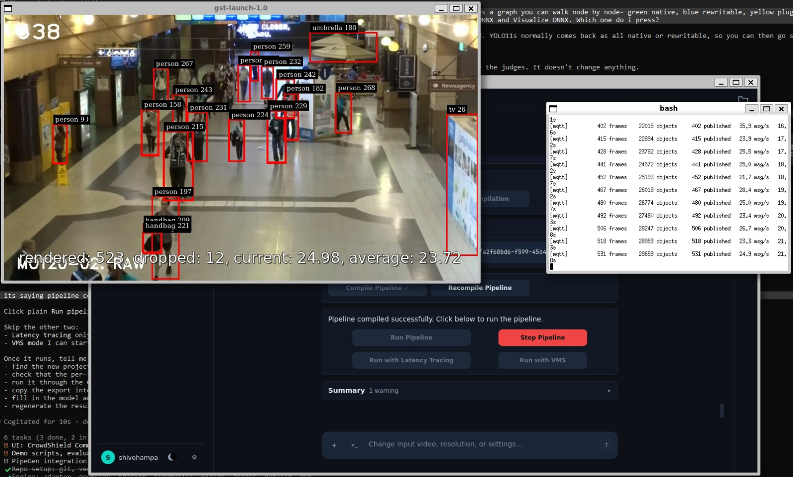
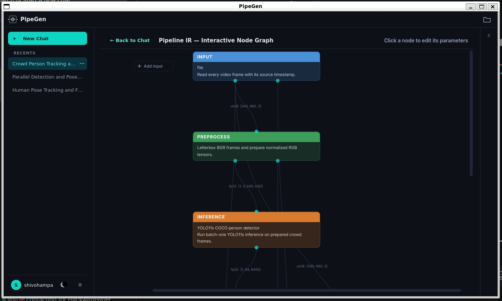
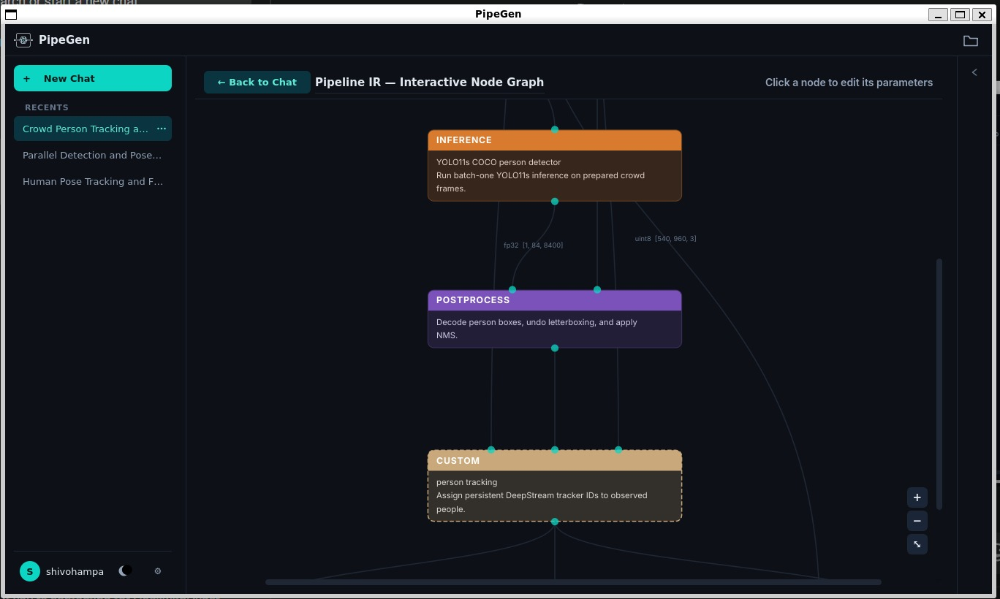
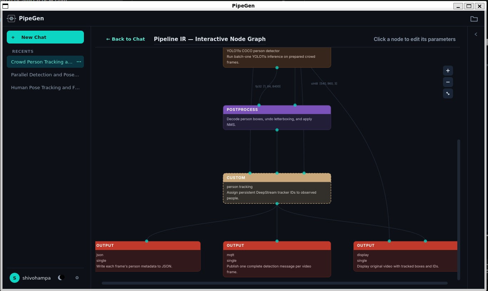
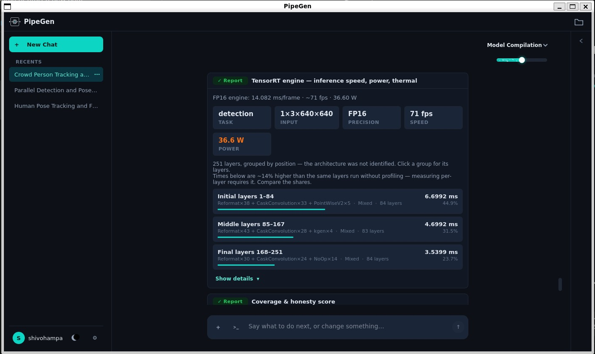
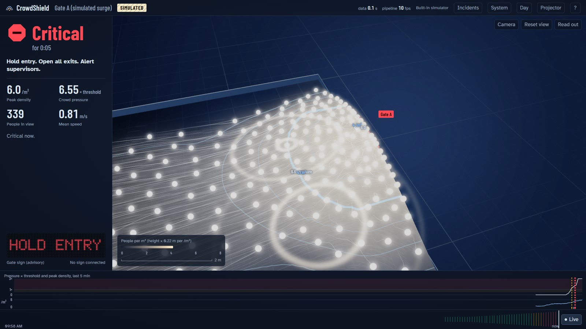
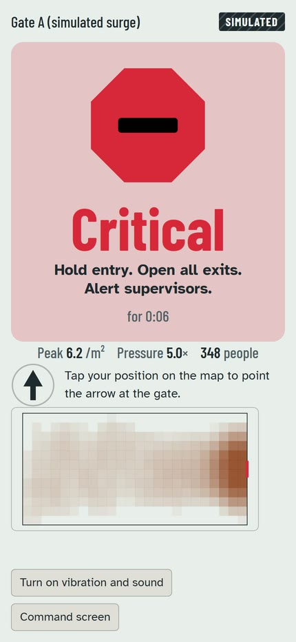

# CrowdShield

CrowdShield is a stampede early-warning system. A PipeGen pipeline runs on an NVIDIA GPU (TensorRT, DeepStream) and detects and tracks every person seen by a fixed camera. CrowdShield maps those people onto the floor in metres and computes three things:
- local density;
- the crowd's flow;
- crowd pressure, as defined by Johansson, Helbing et al. (2008).

From these it advises staff in three steps (Normal, Building, Critical) before a crush forms. It publishes everything as MQTT and shows it on CrowdShield Command, a GPU-rendered operator screen.

It advises trained staff and never controls a gate. It stores positions and metrics, never video or faces.

Built for the Embedded SF × CraftifAI Physical AI Hackathon, Track A (PipeGen). Participant CRA004.

## It running

**PipeGen pipeline on real crowd footage** (MOT20-02): YOLO11s TensorRT FP16 + NVIDIA tracker, boxes with tracker IDs at 25 fps, every frame published over MQTT (the terminal on the right).



**Pipeline IR node graph** generated by PipeGen: source and pre-processing, the TensorRT detector and tracker, then three outputs (JSON metadata, MQTT, live display).

| Input and pre-processing | Inference and tracking | Outputs |
|---|---|---|
|  |  |  |

**PipeGen speed report** on the GTX 1650 laptop GPU: 14.08 ms per frame (about 71 fps) at 36.6 W; FP16 vs FP32 mAP@0.5 0.9904 ([evidence/23](evidence/23_accuracy_fp16_vs_fp32.jpeg)).



**CrowdShield Command and the steward phone** during a surge. This surge is the UI's built-in simulator, labelled SIMULATED on screen: the real MOT20 footage never gets dense enough to escalate.

| Command (Critical, HOLD ENTRY) | Steward phone |
|---|---|
|  |  |

All 51 PipeGen screenshots, numbered by stage, are in [evidence/](evidence/).

## How it fits together

```
camera / video / RTSP
   │
PipeGen 0.5.1 (Requirement → Pipeline IR → Model → Compiler → Run)
   DeepStream app: nvinfer (TensorRT engine) → tracker → meta_json         [GPU, inside PipeGen's container]
   │  per-frame JSON: boxes, tracker IDs, pts_ns       ~/.crowdshield/run/metadata.json  (or VMS TCP :7002, or MQTT)
   ▼
crowdshield.run  (engine, Python, CPU)
   io_pipegen → geometry (homography) → kinematics → fields (density, flow, pressure) → assess (status, forecast)
   │  MQTT crowdshield/{state 5 Hz, status 1 Hz, alerts, actuator/cmd}     docs/DATA_CONTRACT.md
   ▼
Mosquitto ──► ESP32 gate sign (optional, FirmGen; tools/esp32_sim.py is a SIMULATED stand-in)
   │
gateway  (python -m gateway: HTTP + WebSocket :8080, history, incidents, health, calibration, control)
   ▼
CrowdShield Command (/), Steward (/steward), Calibrate (/calibrate), Judge (/judge)
```

PipeGen does all of the perception. CrowdShield runs no neural network: it consumes PipeGen's output and turns it into decisions. See [docs/ARCHITECTURE.md](docs/ARCHITECTURE.md).

## Quick start (WSL Ubuntu with PipeGen installed)

```bash
cd /mnt/c/Users/<you>/OneDrive/Desktop/Projects/Crowd_Detection    # or wherever the repo lives
python3 scripts/doctor.py                                           # GPU, PipeGen, Docker, Mosquitto, ports
python3 -m venv ~/.venvs/crowdshield && ~/.venvs/crowdshield/bin/pip install -r requirements.txt
bash scripts/fetch_videos.sh                                        # public MOTChallenge crowd clips into ~/videos/crowd
bash scripts/demo.sh video                                          # PipeGen run -> engine -> gateway -> browser
```

Then open http://localhost:8080/ in the Windows browser. The demo modes are:

| Command | What it runs | Label on screen |
|---|---|---|
| `scripts/demo.sh video [VIDEO]` | PipeGen's DeepStream app on a video file (a real PipeGen run) | VIDEO via PipeGen |
| `scripts/demo.sh live` | the engine on whatever PipeGen is running (started from PipeGen's Run stage) | LIVE |
| `scripts/demo.sh vms [VIDEO]` | PipeGen VMS mode: metadata over TCP plus MJPEG video for reality lock | VIDEO via PipeGen |
| `scripts/demo.sh replay NAME` | `recordings/NAME.jsonl` through the engine | REPLAY |
| `scripts/demo.sh synthetic NAME` | a synthetic dataset, e.g. `surge__pole_720_body` | SYNTHETIC |
| `scripts/demo.sh sim` | the UI's built-in simulator only | SIMULATED |

`PROFILE=demo scripts/demo.sh ...` lowers the thresholds to 1.5 and 2.5 people/m² for a taped square with a few volunteers. The zone name then shows "(demo profile)".

`CS_SIGN_SIM=1 scripts/demo.sh ...` also starts a SIMULATED ESP32 gate sign (`tools/esp32_sim.py`). It follows `firmware/PRD_gate_sign.md` over MQTT, and the dashboard labels it "Simulated sign". It is not hardware and does not count for the Closed Loop bonus.

No camera or GPU? Open `http://localhost:8080/?src=sim&scenario=surge` after starting `python -m gateway --mqtt none`.

## Run the PipeGen export

[`pipegen_export/`](pipegen_export/) is the CrowdShield PipeGen project (`a2f60bd6-f599-45b4-85ce-69f431eff9fc`): the requirement, the Pipeline IR, the model-stage reports (`model_stage/ModelStage.log`) and the generated DeepStream app (`pipeline/deepstream/run.sh`, configs, parser and plugin sources). The TensorRT engine is not included, because engines are tied to the GPU and TensorRT version.

1. Copy the folder into PipeGen's project store under the same id: `cp -r pipegen_export ~/.pipegen/<your user>/a2f60bd6-f599-45b4-85ce-69f431eff9fc`.
2. Open it in PipeGen (`pipegen`) and re-run **Model → Compile (FP16)**, then **Compiler → Compile Pipeline**. This rebuilds `yolo11s.fp16.plan` for your GPU and the plugin `.so` files.
3. Run it from PipeGen's **Run** stage, or headless from this repo: `PIPEGEN_PROJECT=a2f60bd6-f599-45b4-85ce-69f431eff9fc bash scripts/pipegen_ctl.sh run-video ~/videos/crowd/MOT20-02.mp4`. That runs a copy of `run.sh` with only the video source swapped, and writes per-frame JSON to `~/.crowdshield/run/metadata.json`.
4. Point CrowdShield at it: `bash scripts/demo.sh live` (or `bash scripts/demo.sh video` to start both).

See [pipegen_export/README.md](pipegen_export/README.md) for what the export contains.

## Command line

```bash
python -m crowdshield.run --source SOURCE --calibration config/calibration.json [--profile demo] [--record PATH]
    SOURCE = tail:~/.crowdshield/run/metadata.json   PipeGen's meta_json file, followed as it grows
           | tcp://127.0.0.1:7002                     PipeGen VMS metadata
           | mqtt://localhost:1883/crowdshield/detections
           | jsonl:PATH [--realtime]                  a recording or synthetic dataset
           | folder:DIR | stdin
    --source-label live|video|replay|synthetic   --emit-jsonl PATH|-   --start-wallclock EPOCH (deterministic replays)
    --ts-unit auto|s|ms|us|ns   --coords auto|px|norm   --frame-size WxH   --zone NAME   --broker HOST:PORT|none
python -m gateway [--port 8080] [--mqtt localhost:1883|none] [--replay-jsonl tools/sample_stream.jsonl] [--allow-lan-control]
scripts/pipegen_ctl.sh status | run-video [PATH] | run-vms [PATH] | run-rtsp URL | run-camera DEV | stop | logs | export
python tools/record.py NAME                       record PipeGen's detections (positions only) to recordings/
python tools/track_quality.py recordings/NAME.jsonl
python tools/count_frames.py prepare|fit           hand counts -> detector recall curve
python tools/calibrate_pressure.py recordings/calm.jsonl [--write --yes]
python tools/compare_precision.py recordings/x_fp16.jsonl recordings/x_int8.jsonl
python tools/validate_variants.py                  engine vs the reference numbers (synthetic)
python -m crowdshield.make_results                 regenerate docs/RESULTS.md
```

Tests:
- `python -m pytest`: engine, gateway and the simulated gate sign, 85 tests.
- `node --test tests/ui/ui.test.mjs`: UI maths. The same checks run in the browser at `/selftest`.

## Calibration

1. Tape a rectangle of known size on the floor, for example 3 × 2 m, and measure one extra distance to check against later.
2. Open `/calibrate`. It uses a still frame from the video file, an RTSP stream or an uploaded snapshot. It never opens the camera PipeGen is using.
3. Click the four corners in order: top-left, top-right, bottom-right, bottom-left. Type the rectangle's size, place the gate, then save.
4. Use "Check a distance" against your tape measure. The engine reloads the calibration within 2 s.

`config/calibration.json` currently holds an **approximate** calibration for the MOT20-02 clip, estimated by eye. Its note field says so. Recalibrate before trusting absolute densities.

## Troubleshooting

| Symptom | Cause and fix |
|---|---|
| WSL sees no camera | Normal. Use a video file, or an RTSP stream from a phone camera app (`scripts/pipegen_ctl.sh run-rtsp rtsp://...`). |
| Red "No live data for N s" | The engine gets no frames. Check `scripts/pipegen_ctl.sh status` and `logs`. On the System screen, PipeGen's pipeline must show as running. |
| Broker down | The engine and gateway keep running and reconnect, and the header shows "Reconnecting". Start Mosquitto: `sudo service mosquitto start`. |
| Times look wrong | Check the timestamp unit the engine logged at start (`adapter: timestamp unit ...`) and force it with `--ts-unit`. |
| Density is always 0 | People fall outside the calibrated area, or the coordinates are normalised. Check the calibration, `--coords` and `--frame-size`. |
| Phones cannot open the Steward page | WSL2 is behind NAT. On Windows (admin), forward the port: `netsh interface portproxy add v4tov4 listenport=8080 connectport=8080 connectaddress=<WSL IP>`. Also allow 8080 in the firewall. |
| Port 8080 busy | Stop the other gateway, or run `PORT=8090 scripts/demo.sh ...`. |

## Documents

- [docs/DATA_CONTRACT.md](docs/DATA_CONTRACT.md): topics and messages.
- [docs/FORMULAS.md](docs/FORMULAS.md): the maths.
- [docs/RESULTS.md](docs/RESULTS.md): measured results, generated.
- [docs/PROJECT_DESCRIPTION.md](docs/PROJECT_DESCRIPTION.md): submission text.
- [docs/DEMO_SCRIPT.md](docs/DEMO_SCRIPT.md): the live demo and the pitch.
- [docs/GATEWAY_API.md](docs/GATEWAY_API.md): the gateway API.
- [docs/UI_GUIDE.md](docs/UI_GUIDE.md): how to read the screens.
- [NOTES.md](NOTES.md): decisions and open items.
- [firmware/PRD_gate_sign.md](firmware/PRD_gate_sign.md): the ESP32 gate sign (FirmGen PRD) and its simulated stand-in.
